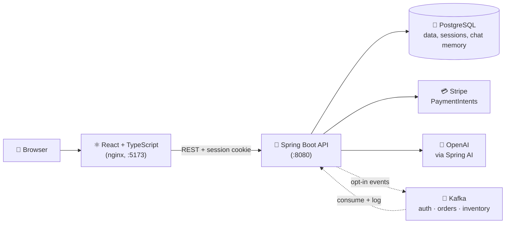

<a id="top"></a>

<div align="center">

# 🛒 RetailForge2

### A full-stack department-store e-commerce platform

**React + TypeScript** on the front · **Spring Boot + PostgreSQL** on the back · **Stripe** checkout · **role-aware AI shopping assistant** · **Kafka** events · **Artillery** load tests · fully **Dockerized**

[](https://react.dev/)
[](https://www.typescriptlang.org/)
[](https://vitejs.dev/)
[](https://openjdk.org/)
[](https://spring.io/projects/spring-boot)
[](https://www.postgresql.org/)
<br/>
[](https://spring.io/projects/spring-ai)
[](https://stripe.com/)
[](https://kafka.apache.org/)
[](https://docs.docker.com/compose/)
[](https://www.artillery.io/)

**[✨ Highlights](#highlights) · [📸 Screenshots](#screenshots) · [🧰 Tech stack](#tech-stack) · [🧠 Architecture](#architecture) · [⚙️ Quick start](#quick-start) · [👤 Demo accounts](#demo-accounts) · [🔌 API](#api-reference) · [🚧 Roadmap](#roadmap)**

<br/>


*The storefront home page — see every page in [Screenshots](#screenshots).*

</div>

---

## 👋 Overview

**RetailForge2** is a full-stack e-commerce platform for a modern department store — a ground-up rebuild of my original RetailForge project on a new stack: **Spring Boot in place of Express.js**, and **TypeScript in place of JavaScript**.

It covers the full customer journey — browsing and search, a server-persisted cart, Stripe checkout, order history, reviews, and favorites — plus a floating **AI shopping/admin assistant** and a complete **admin back office** (CRUD, CSV bulk upload, and CSV export) for departments, categories, products, users, orders, and reviews. Authentication uses Spring Security with server-side sessions stored in Postgres.

<div align="center">

|  | Original RetailForge | **RetailForge2** (this repo) |
|---|---|---|
| **Backend** | Node.js + Express | **Spring Boot 4** (Java 25) |
| **Frontend language** | JavaScript | **TypeScript** |
| **Database** | PostgreSQL | PostgreSQL + **Flyway** migrations |
| **Auth** | Session-based (HTTP-only cookies) | Spring Security + Spring Session JDBC |
| **Payments** | Stripe | Stripe (PaymentIntents + Elements) |
| **AI assistant** | — | **New** — role-aware chat assistant (OpenAI via Spring AI) |
| **Event streaming** | Kafka | Kafka (auth / order / inventory events), opt-in |
| **Load testing** | — | **New** — Artillery suite incl. full checkout journey |
| **Deployment** | — | **New** — Docker Compose (Postgres, backend, nginx frontend, Kafka) |

</div>

<p align="right"><a href="#top">⬆ Back to top</a></p>

---

<a id="table-of-contents"></a>

## 📌 Table of contents

| Product | Engineering | Running it |
|---|---|---|
| [✨ Highlights](#highlights) | [🧰 Tech stack](#tech-stack) | [🧩 Local requirements](#local-requirements) |
| [✅ Features](#features) | [🧠 Architecture](#architecture) | [🔑 Environment files](#environment-files) |
| [📸 Screenshots](#screenshots) | [🔐 Auth & roles](#auth) | [⚙️ Quick start](#quick-start) |
| [🗺️ App routes](#app-routes) | [🤖 AI chat assistant](#ai-chat-assistant) | [👤 Demo accounts](#demo-accounts) |
| [🔌 API reference](#api-reference) | [💳 Payments](#payments) | [🛠️ Development commands](#development-commands) |
| [🚧 Roadmap](#roadmap) | [📡 Kafka events](#kafka-events) | [🛡️ Security / local dev notes](#security--local-dev-notes) |
| | [🧪 Load testing](#load-testing) | [📚 Related docs](#related-docs) |
| | [🗄️ Database & migrations](#database-and-migrations) | |
| | [🖼️ Media & images](#media-and-image-handling) | |
| | [🏗️ Project structure](#project-structure) | |

---

<a id="highlights"></a>

## ✨ Highlights

Beyond the stack rewrite, these are the parts that are new or meaningfully better than the original — not just re-implemented in a different language:

- 🤖 **An AI assistant built from scratch** — a floating chat widget whose tool set is **gated server-side by role**: shoppers can search products, manage their cart and favorites, and look up orders (including the exact items purchased), while `manager`/`employee` sessions also get inventory, top-seller, low-stock, and order-status tools. Chat history is persisted and resumable.
- 🔒 **Real server-side sessions** — Spring Security + BCrypt + Spring Session JDBC replace frontend-only auth. A single merged Login/Register page signs users in immediately, and an **"Are you still there?" inactivity modal** warns users before their session expires.
- 💳 **Stripe checkout end to end** — a PaymentIntent is created first, then the order and its line items are finalized server-side, with stock decremented in the same step.
- ⚡ **Load-tested and hardened** — an Artillery suite covering browsing, failed logins, and the full register → cart → pay → checkout journey surfaced **three real concurrency bugs** in the checkout/cart-write paths. All were fixed, and locking/constraint conflicts now map to clean `409 Conflict` responses instead of server errors.
- 📡 **Event-driven foundation** — auth, order, and inventory events publish to Kafka (opt-in), with a listener proving the publish → broker → consume pipeline end to end.
- 🧰 **One reusable admin CRUD shell** — search, filters, pagination, CSV export, and CSV bulk upload (with template download and row preview) shared across all six admin entities instead of being rebuilt per page.
- 🧑‍💻 **TypeScript across the whole frontend** — catching prop typos, wrong argument types, and null-unsafe access at compile time.
- 🐳 **One-command startup** — `docker compose up` builds multi-stage images for the backend (Temurin JRE) and the frontend (served by nginx), with health checks on every service.

<p align="right"><a href="#top">⬆ Back to top</a></p>

---

<a id="features"></a>

## ✅ Features

<table>
<tr>
<td valign="top" width="50%">

### 🛍️ Storefront (everyone)

- Home page with featured-product showcase
- Product listing with search, department/category filters, sorting, and pagination
- Product detail page with customer reviews
- Merged Login / Register page backed by real server sessions
- Floating AI chat assistant, available to guests too

### 🙋 Customer account (signed in)

- Server-persisted cart with quantity steppers and low-stock hints
- Stripe Elements checkout with a pre-filled, editable shipping address
- Order confirmation receipt
- Order history and per-order detail pages
- Favorites
- Write, edit, and delete your own reviews
- Profile page with avatar upload
- Inactivity warning before the session times out

</td>
<td valign="top" width="50%">

### 🛠️ Admin back office (`manager` / `employee`)

- Dashboards + create/update/delete for **departments, categories, products, users, orders, and reviews**
- CSV **bulk upload** (template download + row preview) for departments, categories, products, users, and reviews
- CSV **export** from every dashboard and from the order detail page
- Order status management
- Multipart image upload for products and user avatars
- Admin routes guarded for `manager` and `employee` roles
- Admin-only AI tools: top sellers, inventory levels, low/out-of-stock products, order-status breakdown

### 📈 Observability & quality

- Kafka events for auth, orders, and inventory (opt-in)
- Artillery load tests for browsing, failed logins, and checkout
- Spring Boot Actuator health checks wired into Docker Compose

</td>
</tr>
</table>

<p align="right"><a href="#top">⬆ Back to top</a></p>

---

<a id="screenshots"></a>

## 📸 Screenshots

Screenshots are grouped by who is looking at the app. Click a group to expand it.

| Group | What's inside |
|---|---|
| [🌐 Not signed in](#shots-guest) | Home, product listing, product detail, login, register |
| [🙋 Customer signed in](#shots-customer) | Home, profile, orders, order details, reviews, favorites |
| [🛒 Cart & checkout](#shots-checkout) | Cart (empty and with items), checkout, order confirmation |
| [🛠️ Admin (Manager) signed in](#shots-admin) | Departments, categories, products, orders, users, reviews |
| [🤖 AI store assistant](#shots-ai) | Manager session, customer session, recent chats |

<a id="shots-guest"></a>

<details open>
<summary><strong>🌐 Not signed in</strong></summary>

#### `HomePage.tsx` · `/`
The public landing page — a showcase of featured products and category entry points for visitors who haven't signed in yet.


#### `ProductsPage.tsx` · `/products`
The storefront product listing, with search, category/department filters, sorting, and pagination — fully browsable as a guest.


#### `ProductInfoPage.tsx` · `/products/:id`
The product detail page, showing full product info alongside customer reviews for that product.


#### `AuthPage.tsx` — Login · `/login`
The merged authentication page's login tab, backed by real backend sessions rather than frontend-only auth.


#### `AuthPage.tsx` — Register · `/register`
The registration tab of the same page — creates an account and signs the user in immediately afterward.


</details>

<a id="shots-customer"></a>

<details>
<summary><strong>🙋 Customer signed in</strong></summary>

#### `HomePage.tsx` · `/`
The same landing page, now rendered for an authenticated customer — the navbar switches to an account menu and cart access.


#### `MyProfilePage.tsx` · `/my-profile`
The customer's account profile, including avatar upload and personal details.


#### `MyOrdersPage.tsx` · `/my-orders`
Order history for the signed-in customer — past orders with status, date, and total at a glance.


#### `OrderDetailsPage.tsx` · `/order-details/:id`
The full detail view for a single order, including purchased items with images, shipping address, and order status.


#### `MyReviewsPage.tsx` · `/my-reviews`
Where customers can view, edit, or delete the reviews they've written for products they've purchased.


#### `MyFavoritesPage.tsx` · `/my-favorites`
Saved/favorited products the customer has bookmarked for later.


</details>

<a id="shots-checkout"></a>

<details>
<summary><strong>🛒 Cart & checkout (customers and admins)</strong></summary>

> The cart, checkout, and order confirmation pages are only available to signed-in users — customers and admin (`manager`/`employee`) accounts. Guests who open `/cart` are redirected to the login page.

#### `CartPage.tsx` — Empty cart · `/cart`
The empty-cart state for a signed-in user, with a quick way back to browsing products.


#### `CartPage.tsx` — Cart with items · `/cart`
The server-persisted cart: quantity steppers capped at available stock, "only N left" low-stock hints, per-line totals, remove/clear actions, and an order summary with a **Proceed to Checkout** button.


#### `CheckoutPage.tsx` · `/checkout`
Stripe Elements checkout — an order summary next to a shipping address (pre-filled from the user's profile and editable) and Stripe's secure Payment Element. Payment is confirmed through a PaymentIntent before the order is created server-side.


#### `OrderConfirmationPage.tsx` · `/order-confirmation`
The post-payment receipt — order total, status, date, and ship-to address, followed by an itemized table of everything purchased, with links back to each product.


</details>

<a id="shots-admin"></a>

<details>
<summary><strong>🛠️ Admin (Manager) signed in</strong></summary>

#### `HomePage.tsx` · `/`
The landing page as seen by a manager/employee account — the navbar now exposes the Admin menu.


#### `AdminDepartmentsPage.tsx` — Dashboard · `/admin/departments`
Department management: a searchable, filterable, paginated list of all departments with edit/delete actions.


#### `AdminDepartmentsPage.tsx` — Add Department · `/admin/departments`
The department creation form, plus CSV bulk upload for adding multiple departments at once.


#### `AdminCategoriesPage.tsx` — Dashboard · `/admin/categories`
Category management dashboard, mirroring the department dashboard's search/filter/edit/delete flow.


#### `AdminCategoriesPage.tsx` — Add Category · `/admin/categories`
Category creation form with CSV bulk upload support.


#### `AdminProductsPage.tsx` — Dashboard · `/admin/products`
Product management dashboard covering the full catalog, with search/filter and per-product image handling.


#### `AdminProductsPage.tsx` — Add Product · `/admin/products`
Product creation form supporting a multipart image upload alongside CSV bulk upload for adding many products at once.


#### `AdminOrdersPage.tsx` · `/admin/orders`
Orders management dashboard — clickable order cards showing the customer, status, item count, and total for every order in the store.


#### `AdminOrderDetailPage.tsx` · `/admin/orders/:id`
The admin's order detail view — update order status, review purchased items, and export the order to CSV.


#### `AdminUsersPage.tsx` — Dashboard · `/admin/users`
User management dashboard listing every account, its role, and avatar, with edit/delete actions.


#### `AdminUsersPage.tsx` — Add User · `/admin/users`
User creation form including role assignment and avatar upload, plus CSV bulk upload.


#### `AdminReviewsPage.tsx` — Dashboard · `/admin/reviews`
Review moderation dashboard covering every review left across the store, with edit/delete actions.


#### `AdminReviewsPage.tsx` — Add Review · `/admin/reviews`
Form for an admin to add or edit a review on a customer's behalf, plus CSV bulk upload.


</details>

<a id="shots-ai"></a>

<details>
<summary><strong>🤖 AI store assistant in action</strong></summary>

#### `ChatWidget.tsx` — Admin/Manager session
Logged in as a manager, asking for sales and inventory insight — an admin-only tool the assistant only exposes because the backend recognizes the `manager`/`employee` role, not because the UI happens to hide a button.


#### `ChatWidget.tsx` — Customer session
Logged in as a shopper, asking about a recent order — the assistant pulls real order data, including status and every item purchased in it, straight from the database.


#### `ChatWidget.tsx` — Recent chats panel
Past conversations are session-scoped and persisted server-side, so they're still there after a refresh or a return visit — for guests and logged-in users alike.


</details>

<p align="right"><a href="#top">⬆ Back to top</a></p>

---

<a id="tech-stack"></a>

## 🧰 Tech stack

| Layer | Technologies |
|---|---|
| **Frontend** | React 19, TypeScript 6, Vite 8, React Router 7, Axios, MUI / Emotion, Bootstrap, styled-components, Stripe.js + React Stripe.js, react-markdown + remark-gfm (renders AI replies) |
| **Backend** | Java 25, Spring Boot 4.1 (Web MVC, Data JPA, Validation, Actuator), Spring Security (BCrypt), Spring Session JDBC, Flyway, Lombok |
| **AI** | Spring AI — OpenAI (active) and Anthropic Claude starters, JDBC-backed chat memory |
| **Payments** | Stripe Java SDK + Stripe Elements (PaymentIntents) |
| **Data & messaging** | PostgreSQL 18, Apache Kafka 3.8 (KRaft mode, no Zookeeper) via `spring-kafka` |
| **Infrastructure** | Docker Compose; multi-stage Dockerfiles (Temurin 25 JRE backend, nginx-served frontend); Actuator health checks |
| **Tooling** | Maven Wrapper, npm, ESLint, Prettier, Artillery |

<p align="right"><a href="#top">⬆ Back to top</a></p>

---

<a id="architecture"></a>

## 🧠 Architecture



Key design decisions:

- **Server-persisted everything** — auth sessions, cart, favorites, and chat history all live in Postgres (Spring Session JDBC / JPA) rather than `localStorage`, so state survives refreshes and stays consistent across tabs and devices.
- **Role-aware AI, enforced on the server** — the same chat widget serves shoppers and admins, but admin tools are only registered for `manager`/`employee` sessions. Hiding a button in the UI isn't the security boundary; the backend is.
- **Two-step, stock-safe checkout** — Stripe confirms payment through a PaymentIntent first, then `/api/payment/complete-checkout` creates the order and its items and decrements stock, keeping payment and order creation as separate, auditable steps.
- **Concurrency-safe writes** — load testing exposed race conditions in checkout and cart-item writes; they were fixed, and optimistic-locking and constraint conflicts are mapped to `409 Conflict` by a global exception handler.
- **Schema owned by Flyway** — JPA runs with `ddl-auto=validate`, so every schema change is a versioned migration.
- **One design language** — compact summary tiles, uncropped product thumbnails (`object-fit: contain` in a padded frame), and a shared "back to …" link pattern across customer and admin detail pages.

<p align="right"><a href="#top">⬆ Back to top</a></p>

---

<a id="app-routes"></a>

## 🗺️ App routes

| Route | Page | Access |
|---|---|---|
| `/` | Home | Everyone |
| `/auth`, `/login`, `/register` | Merged Login / Register page | Everyone |
| `/products` | Product listing | Everyone |
| `/products/:id` | Product detail + reviews | Everyone |
| `/cart` | Server-persisted cart | Signed in (customer, manager, employee) |
| `/checkout` | Stripe Elements checkout | Signed in (customer, manager, employee) |
| `/order-confirmation` | Post-checkout receipt | Signed in (customer, manager, employee) |
| `/my-profile` | Profile + avatar upload | Signed in |
| `/my-favorites` | Saved favorites | Signed in |
| `/my-reviews` | Reviews you've written | Signed in |
| `/my-orders` | Order history | Signed in |
| `/order-details/:id` | Customer order detail | Signed in |
| `/admin/departments` | Department management | `manager`, `employee` |
| `/admin/categories` | Category management | `manager`, `employee` |
| `/admin/products` | Product management | `manager`, `employee` |
| `/admin/users` | User management | `manager`, `employee` |
| `/admin/reviews` | Review management | `manager`, `employee` |
| `/admin/orders`, `/admin/orders/:id` | Order management + status updates | `manager`, `employee` |

<p align="right"><a href="#top">⬆ Back to top</a></p>

---

<a id="api-reference"></a>

## 🔌 API reference

| Area | Endpoints |
|---|---|
| **Auth** | `POST /api/auth/register` · `POST /api/auth/login` · `POST /api/auth/logout` · `GET /api/auth/me` |
| **Departments** | `GET/POST /api/departments` · `GET/PUT/DELETE /api/departments/{id}` · `POST /api/departments/bulk` |
| **Categories** | `GET/POST /api/categories` · `GET/PUT/DELETE /api/categories/{id}` · `POST /api/categories/bulk` |
| **Products** | `GET/POST /api/products` · `GET/PUT/DELETE /api/products/{id}` (multipart for create/update) · `POST /api/products/bulk` |
| **Users** | `GET/POST /api/users` · `GET/PUT/DELETE /api/users/{id}` · `PUT /api/users/{id}/avatar` · `POST /api/users/bulk` |
| **Cart** | `GET/DELETE /api/cart` · `POST /api/cart/items` · `PATCH/DELETE /api/cart/items/{productId}` |
| **Reviews** | `GET/POST /api/reviews` · `GET/PUT/DELETE /api/reviews/{id}` · `GET /api/reviews/product/{id}` · `GET /api/reviews/user/{id}` · `POST /api/reviews/bulk` |
| **Favorites** | `GET /api/favorites/user/{userId}` · `GET /api/favorites/user/{userId}/ids` · `GET/POST/DELETE /api/favorites/user/{userId}/product/{productId}` |
| **Orders (admin)** | `GET/POST /api/admin/orders` · `GET/PUT/DELETE /api/admin/orders/{id}` · `GET /api/admin/orders/user/{userId}` · `GET /api/admin/orders/status/{status}` · `PUT /api/admin/orders/{id}/status` |
| **Order details** | `GET /api/order-details/order/{orderId}` |
| **Payments** | `POST /api/payment/create-payment-intent` · `POST /api/payment/complete-checkout` |
| **AI chat** | `POST /api/chat` · `GET/POST/DELETE /api/chat/sessions` · `GET /api/chat/sessions/{id}/messages` · `POST /api/chat/sessions/{id}/clear` · `DELETE /api/chat/sessions/{id}` |
| **Health** | `GET /actuator/health` · `GET /actuator/info` |

**Access rules** (from `SecurityConfig`): catalog reads (products, categories, departments, reviews), the chat endpoints, `/images/**`, and the health endpoints are public; review writes need any signed-in user; catalog writes need `MANAGER` or `EMPLOYEE`; everything else requires authentication.

<p align="right"><a href="#top">⬆ Back to top</a></p>

---

<a id="auth"></a>

## 🔐 Auth & roles

- Spring Security handles login/logout with **BCrypt**-hashed passwords.
- Sessions are stored server-side with **Spring Session JDBC** (cookie-based). The frontend sends credentials with every request, and CORS allows `http://localhost:5173` with credentials.
- Roles (`UserRole` enum): `CUSTOMER`, `MANAGER`, `EMPLOYEE`. Admin pages require `MANAGER` or `EMPLOYEE`.
- Registering signs the user in immediately, and the navbar switches between guest actions and an account menu.
- Sessions time out after **4 hours** of inactivity. Two hours before that, an **"Are you still there?"** modal lets the user stay signed in or log out right away.
- Demo users are seeded by the `V6__seed_demo_users.sql` Flyway migration — see [Demo accounts](#demo-accounts).

<p align="right"><a href="#top">⬆ Back to top</a></p>

---

<a id="ai-chat-assistant"></a>

## 🤖 AI chat assistant

A floating chat widget (`ChatWidget.tsx`) is available on every page, for guests and signed-in users, powered by **OpenAI through Spring AI**. Anthropic Claude is also wired up and can be swapped in with one config change (`spring.ai.model.chat`).

- **Persistent, resumable history** — conversations live in a `chat_sessions` table plus Spring AI's JDBC-backed chat memory. Guests are scoped by a guest session key and signed-in users by user id, and both can switch between past conversations in the recent-chats panel.
- **Shopper tools** — product search, cart and favorites management, order lookup (including the items in a given order), popular products, and product reviews.
- **Admin-only tools** (`manager`/`employee` sessions) — top sellers, current inventory, out-of-stock/low-stock products, and order-status breakdown.

See it in action in [Screenshots → AI store assistant](#shots-ai).

<p align="right"><a href="#top">⬆ Back to top</a></p>

---

<a id="payments"></a>

## 💳 Payments

1. The frontend wraps `CheckoutPage` in Stripe's `<Elements>` provider using `VITE_STRIPE_PUBLISHABLE_KEY` and renders Stripe's Payment Element.
2. The backend creates a PaymentIntent via `POST /api/payment/create-payment-intent`.
3. After Stripe confirms payment, `POST /api/payment/complete-checkout` creates the order and its items, decrements stock, and (when Kafka is on) publishes order and inventory events.

Use Stripe test keys (`sk_test_…` / `pk_test_…`) and a test card such as `4242 4242 4242 4242` for local checkout.

<p align="right"><a href="#top">⬆ Back to top</a></p>

---

<a id="kafka-events"></a>

## 📡 Kafka events

Kafka is **off by default** (`KAFKA_ENABLED=false`), so the app runs exactly the same with or without a broker.

| Topic | Published when |
|---|---|
| `rf2.auth` | Every login attempt (success or failure) and every successful registration |
| `rf2.orders` | A checkout completes (`PaymentService.completeCheckout`) |
| `rf2.inventory` | A product's stock changes — from an admin create/update/bulk upload or a checkout — flagged when it's at or below `LOW_STOCK_THRESHOLD` |

A `KafkaEventListener` subscribes to all three topics and logs what arrives, proving the full publish → broker → consume pipeline. These events are a foundation for future consumers (email alerts, a live dashboard), not a finished feature on their own.

### Enabling Kafka

1. Set `KAFKA_ENABLED=true` in your `.env`.
2. Start the stack with the `kafka` Compose profile:

   ```powershell
   docker compose --profile kafka up --build -d
   ```

3. Watch events arrive in the backend logs:

   ```powershell
   docker compose logs backend --tail=100 -f
   ```

The broker is reachable as `kafka:9092` from other containers and as `localhost:29092` from your machine. If you run the backend outside Docker with Kafka on, set `KAFKA_BOOTSTRAP_SERVERS=localhost:29092`.

<p align="right"><a href="#top">⬆ Back to top</a></p>

---

<a id="load-testing"></a>

## 🧪 Load testing

An [Artillery](https://www.artillery.io/) suite in `load-testing/` runs three scenarios against a running backend:

| Command | Scenario |
|---|---|
| `npm run test:browse` | Anonymous catalog browsing |
| `npm run test:login-failed` | Repeated failed logins (checks that BCrypt's intentional slowness holds up under load) |
| `npm run test:checkout` | Full journey: register a fresh account → add to cart → create a Stripe PaymentIntent → complete checkout |

`test:checkout` registers a new account per virtual user so users don't fight over one shared cart. Each run adds rows to the `users` table — fine locally, but don't point it at a shared database.

```powershell
Set-Location .\load-testing
npm install
npm run test:browse
npm run test:login-failed
npm run test:checkout
```

Requires the backend at `http://localhost:8080`. This suite surfaced three real concurrency bugs in the checkout and cart-write paths, all now fixed — see the commit history for details.

<p align="right"><a href="#top">⬆ Back to top</a></p>

---

<a id="local-requirements"></a>

## 🧩 Local requirements

- Docker Desktop / Docker Compose
- Node.js + npm (for frontend development and load testing)
- Java 25 JDK (for running the backend outside Docker — `pom.xml` targets Java 25)

<p align="right"><a href="#top">⬆ Back to top</a></p>

---

<a id="environment-files"></a>

## 🔑 Environment files

| File | Purpose |
|---|---|
| `.env.example` → `.env` | Values Docker Compose passes to the containers |
| `frontend/.env.example` → `frontend/.env` | Frontend values when running `npm run dev` |
| `backend/application-secrets.properties.example` → `backend/application-secrets.properties` | AI provider keys when running the backend outside Docker |

All real `.env` and `application-secrets.properties` files are gitignored.

### Root `.env`

| Variable | Example / default | Notes |
|---|---|---|
| `POSTGRES_DB` / `POSTGRES_USER` / `POSTGRES_PASSWORD` | `retailforge2` / `retailforge2_user` / `retailforge2_dev_password` | Database container credentials |
| `STRIPE_SECRET_KEY` / `STRIPE_PUBLISHABLE_KEY` | `sk_test_…` / `pk_test_…` | Stripe test keys |
| `SPRING_AI_OPENAI_API_KEY` | `sk-…` | Used while `spring.ai.model.chat=openai` |
| `SPRING_AI_ANTHROPIC_API_KEY` | `sk-…` | Used if you switch the provider to `anthropic` |
| `KAFKA_ENABLED` | `false` | Turns event publishing/consuming on |
| `KAFKA_BOOTSTRAP_SERVERS` | `kafka:9092` | Broker address from inside Docker |
| `KAFKA_CLIENT_ID` / `KAFKA_CONSUMER_GROUP_ID` | `retailforge2-backend` | Kafka client identity |
| `KAFKA_TOPIC_ORDERS` / `KAFKA_TOPIC_AUTH` / `KAFKA_TOPIC_INVENTORY` | `rf2.orders` / `rf2.auth` / `rf2.inventory` | Topic names |
| `LOW_STOCK_THRESHOLD` | `5` | Stock level flagged as "low" in inventory events |
| `VITE_API_BASE_URL` | `http://localhost:8080` | Baked into the frontend bundle at build time |

### Frontend `frontend/.env`

| Variable | Example | Notes |
|---|---|---|
| `VITE_API_BASE_URL` | `http://localhost:8080` | Backend URL |
| `VITE_STRIPE_PUBLISHABLE_KEY` | `pk_test_…` | Required by the checkout page's Stripe Elements provider |

### Backend AI keys (local runs)

Copy `backend/application-secrets.properties.example` to `backend/application-secrets.properties` and set `spring.ai.openai.api-key`. The backend imports this file automatically if it exists; the `SPRING_AI_*` environment variables work too.

<p align="right"><a href="#top">⬆ Back to top</a></p>

---

<a id="quick-start"></a>

## ⚙️ Quick start

### Option 1 — Full stack with Docker (recommended)

```powershell
copy .env.example .env      # then fill in your Stripe and OpenAI test keys
docker compose up --build -d
```

| Service | URL |
|---|---|
| Frontend | http://localhost:5173 |
| Backend API | http://localhost:8080 |
| PostgreSQL | `localhost:5434` |

Check that everything is healthy with `docker compose ps`. To add Kafka, set `KAFKA_ENABLED=true` and run `docker compose --profile kafka up --build -d` — see [Kafka events](#kafka-events).

> 💡 Every service uses `restart: unless-stopped`, so the stack starts again with Docker Desktop. Run `docker compose down` (or `docker stop retailforge2-backend`) before starting the backend locally, or port `8080` will already be taken.

### Option 2 — Local development (hot reload)

**1. Start PostgreSQL only**

```powershell
docker compose up -d postgres
```

**2. Start the backend** (from the `backend` folder, so `${user.dir}/media` resolves to `backend/media`)

```powershell
Set-Location .\backend
.\mvnw.cmd spring-boot:run
```

Defaults from `application.properties`: port `8080`, datasource `jdbc:postgresql://localhost:5434/retailforge2`, media root `${user.dir}/media`. Create `application-secrets.properties` if you want the AI assistant to work locally.

**3. Start the frontend**

```powershell
Set-Location .\frontend
npm install
npm run dev
```

The frontend expects the backend at `http://localhost:8080` unless `VITE_API_BASE_URL` is overridden.

<p align="right"><a href="#top">⬆ Back to top</a></p>

---

<a id="demo-accounts"></a>

## 👤 Demo accounts

These accounts are seeded by the `V6__seed_demo_users.sql` migration:

| Role | Email |
|---|---|
| Customer | `customer.demo@retailforge.com` |
| Manager | `manager.demo@retailforge.com` |
| Employee | `employee.demo@retailforge.com` |
| Manager (admin) | `admin@retailforge.com` |

You can also register a new customer account from `/register`.

<p align="right"><a href="#top">⬆ Back to top</a></p>

---

<a id="development-commands"></a>

## 🛠️ Development commands

| Area | Commands |
|---|---|
| **Frontend** (`frontend/`) | `npm install` · `npm run dev` · `npm run build` · `npm run lint` · `npm run preview` |
| **Backend** (`backend/`) | `.\mvnw.cmd spring-boot:run` · `.\mvnw.cmd test` |
| **Load testing** (`load-testing/`) | `npm install` · `npm run test:browse` · `npm run test:login-failed` · `npm run test:checkout` |
| **Docker** (project root) | `docker compose up --build -d` · `docker compose ps` · `docker compose logs backend -f` · `docker compose down` |

<p align="right"><a href="#top">⬆ Back to top</a></p>

---

<a id="database-and-migrations"></a>

## 🗄️ Database & migrations

Flyway migrations live in `backend/src/main/resources/db/migration/`. JPA runs with `spring.jpa.hibernate.ddl-auto=validate`, so the schema always comes from Flyway.

| # | Migration | # | Migration |
|---|---|---|---|
| V1 | `create_spring_session_tables` | V8 | `create_cart_items_table` |
| V2 | `create_departments_table` | V9 | `create_orders_table` |
| V3 | `create_categories_table` | V10 | `create_order_items_table` |
| V4 | `create_products_table` | V11 | `create_reviews_table` |
| V5 | `create_users_table` | V12 | `create_favorites_table` |
| V6 | `seed_demo_users` | V13 | `create_ai_chat_memory_tables` |
| V7 | `create_carts_table` | V14 | `create_chat_sessions_table` |

<p align="right"><a href="#top">⬆ Back to top</a></p>

---

<a id="media-and-image-handling"></a>

## 🖼️ Media & image handling

Uploaded and shared images live in the backend's `media` folder (a named volume in Docker):

| Folder | Served at |
|---|---|
| `backend/media/product_images/` | `/images/product_images/<filename>` |
| `backend/media/other_images/` | `/images/other_images/<filename>` |

The frontend falls back to `/images/other_images/dummy_product.jpg` when a product has no image. See `docs/admin-products-media-setup.md` for the media workflow and CSV image-path rules.

<p align="right"><a href="#top">⬆ Back to top</a></p>

---

<a id="project-structure"></a>

## 🏗️ Project structure

```text
RetailForge2/
├─ frontend/                 React + TypeScript app (Vite; Dockerfile + nginx.conf)
│  └─ src/
│     ├─ pages/              storefront, checkout, account (mypages/), and admin pages
│     ├─ components/         navbar, product cards, chat widget, admin tables/layout
│     ├─ api/                API clients (cart, orders, favorites, reviews, chat, users, products)
│     ├─ context/            auth and favorites providers
│     ├─ hooks/              useAuth, useChat, useFavorites, session-timeout warning, …
│     └─ routes/             AppRoutes.tsx (incl. Stripe <Elements>) and RequireRole guard
├─ backend/                  Spring Boot app (Dockerfile)
│  ├─ src/main/java/.../
│  │  ├─ controllers/        REST controllers + global exception handler
│  │  ├─ services/           business logic, AI chat tools, Kafka publisher/listener
│  │  ├─ security/           Spring Security + session config
│  │  ├─ config/             Kafka producer/consumer and topic beans
│  │  ├─ events/             Kafka event records (auth, order, inventory)
│  │  └─ models/, repository/, mappers/
│  ├─ src/main/resources/db/migration/   Flyway migrations
│  └─ media/                 product and avatar images
├─ load-testing/             Artillery scenarios
├─ docs/                     setup notes
├─ docker-compose.yml        PostgreSQL, backend, frontend, and optional Kafka
└─ .env.example              root environment template
```

<p align="right"><a href="#top">⬆ Back to top</a></p>

---

<a id="security--local-dev-notes"></a>

## 🛡️ Security / local dev notes

- CORS is restricted to `http://localhost:5173` with credentials enabled (required for session cookies). The origin is set in `SecurityConfig.java`, so keep the frontend on port `5173` unless you change it there too.
- Stripe and AI keys are read from environment variables (`STRIPE_*`, `SPRING_AI_*`) or the gitignored `application-secrets.properties` — `application.properties` only holds placeholder defaults.
- Don't commit real `.env` / `application-secrets.properties` files or generated output (`frontend/dist/`, `node_modules/`, `backend/target/`).
- If Docker volumes already contain older database state, read `docs/postgres-setup.md` before resetting the database.

<p align="right"><a href="#top">⬆ Back to top</a></p>

---

<a id="roadmap"></a>

## 🚧 Roadmap

- Password reset and email verification
- Rate limiting on the public chat endpoint
- Broader automated test coverage (unit + integration) for the order, payment, and chat flows
- Real consumers for Kafka events (low-stock email alerts, a live sales dashboard)
- Production deployment: managed secrets, HTTPS, and a configurable CORS origin

<p align="right"><a href="#top">⬆ Back to top</a></p>

---

<a id="related-docs"></a>

## 📚 Related docs

- [`docs/postgres-setup.md`](docs/postgres-setup.md) — PostgreSQL + Docker setup details
- [`docs/admin-products-media-setup.md`](docs/admin-products-media-setup.md) — product image/media setup notes

<p align="right"><a href="#top">⬆ Back to top</a></p>
